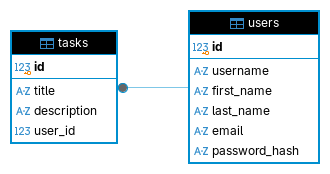

# Todo List API

API REST para gestionar tareas personales, desarrollada con Spring Boot y PostgreSQL como proyecto de práctica del reto [Todo List API de roadmap.sh](https://roadmap.sh/projects/todo-list-api).

El objetivo es practicar desarrollo backend: desde la persistencia y las operaciones CRUD hasta la autenticación y el control de acceso. Cada usuario puede gestionar sus propias tareas.

## Índice

- [Características](#características)
- [Requisitos](#requisitos)
- [Implementación](#implementación)
- [Arquitectura](#arquitectura)
- [Diagrama de la base de datos](#diagrama-de-la-base-de-datos)
- [Instalación](#instalación)
- [Uso](#uso)
- [Endpoints](#endpoints)
- [Rate limiting](#rate-limiting)
- [Pruebas](#pruebas)
- [Principios aplicados](#principios-aplicados)
- [Referencias](#referencias)

## Características

- Registro de usuarios con correo y nombre de usuario únicos.
- Almacenamiento seguro de contraseñas mediante hash.
- Inicio de sesión y autenticación con JWT.
- Creación, consulta, actualización y eliminación de tareas.
- Acceso a las tareas restringido a su propietario.
- Validación de peticiones y respuestas de error con códigos HTTP adecuados.
- Listado de tareas con paginación y filtro por título.
- Persistencia en PostgreSQL.
- Límite configurable de peticiones por minuto por usuario autenticado.

## Requisitos

- JDK 17 o superior.
- PostgreSQL y acceso a una base de datos para el proyecto.
- Maven Wrapper incluido; no es necesario instalar Maven por separado.

## Implementación

- Java 17.
- Spring Boot 4.1.1.
- Maven, con Maven Wrapper incluido.
- Spring Web MVC para los endpoints REST.
- Spring Data JPA para la persistencia.
- PostgreSQL como base de datos.
- Bean Validation para validar las peticiones.
- Spring Security y JWT para autenticación y autorización.
- Bucket4j para limitar las peticiones por usuario.

## Arquitectura

La aplicación está organizada por capas dentro de `tech.mrodriguez.todo`:

```text
config       → configuración de Spring, seguridad y JWT
controller   → endpoints REST
service      → lógica de negocio, autenticación y límites de peticiones
repository   → acceso a la base de datos
model/dto    → datos de entrada y salida de la API
model/entity → entidades persistidas
mapper       → conversión entre entidades y DTOs
interceptor  → control de peticiones antes de ejecutar el controlador
exception    → manejo centralizado de errores
```

Los controladores delegan la lógica en servicios y los repositorios gestionan
la persistencia. Spring Security valida el JWT antes de acceder a las tareas.

## Diagrama de la base de datos

El modelo relaciona usuarios y tareas: un usuario puede tener varias tareas y cada tarea pertenece a un único usuario mediante la clave foránea `tasks.user_id`.



## Instalación

### 1. Clonar el repositorio

```bash
git clone https://github.com/mrodriguezdev/todo-list-api.git
cd todo-list-api
```

### 2. Configurar la aplicación

```bash
cp src/main/resources/application-local.properties.example src/main/resources/application-local.properties
```

Configura las credenciales de PostgreSQL y `JWT_SECRET` en el archivo local:

| Variable | Propósito |
| --- | --- |
| `DB_HOST` | Host de PostgreSQL. |
| `DB_PORT` | Puerto de PostgreSQL. |
| `DB_NAME` | Nombre de la base de datos. |
| `DB_USERNAME` | Usuario de la base de datos. |
| `DB_PASSWORD` | Contraseña de la base de datos. |
| `JWT_SECRET` | Clave en Base64 de al menos 32 bytes para firmar los JWT. |
| `RATE_LIMIT_REQUESTS_PER_MINUTE` | Peticiones permitidas por minuto por usuario. |

Genera el secreto con:

```bash
openssl rand -base64 32
```

El perfil `local` está activo en `application.properties`, por lo que Spring Boot
carga automáticamente el archivo local. Este archivo está ignorado por Git.
No se necesita un archivo `.env`.

### 3. Preparar la base de datos

Crea la base de datos configurada en `DB_NAME`. En una base de datos vacía,
ejecuta `src/main/resources/db/schema.sql` para crear las tablas y sus relaciones.

### 4. Ejecutar la aplicación

```bash
./mvnw spring-boot:run
```

La API estará disponible en `http://localhost:8080`.

## Uso

### Registrar un usuario

```bash
curl -X POST http://localhost:8080/auth/register \
  -H 'Content-Type: application/json' \
  -d '{"username":"mario","firstName":"Mario","email":"mario@example.com","password":"Ejemplo2026!"}'
```

### Iniciar sesión

```bash
curl -X POST http://localhost:8080/auth/login \
  -H 'Content-Type: application/json' \
  -d '{"username":"mario","password":"Ejemplo2026!"}'
```

Registro e inicio de sesión devuelven un campo `token`. Sustituye `<token>` por
ese valor en las peticiones protegidas.

### Crear una tarea

```bash
curl -X POST http://localhost:8080/tasks \
  -H 'Authorization: Bearer <token>' \
  -H 'Content-Type: application/json' \
  -d '{"title":"Comprar comida","description":"Completar antes del viernes"}'
```

### Listar y filtrar tareas

```bash
curl 'http://localhost:8080/tasks?page=1&limit=10&title=Comprar' \
  -H 'Authorization: Bearer <token>'
```

## Endpoints

| Método | Ruta | Propósito | Requiere autenticación |
| --- | --- | --- | --- |
| `POST` | `/auth/register` | Registrar un usuario y obtener un JWT. | No |
| `POST` | `/auth/login` | Iniciar sesión y obtener un JWT. | No |
| `POST` | `/tasks` | Crear una tarea. | Sí |
| `GET` | `/tasks?page=1&limit=10&title=Comprar` | Listar tareas con paginación y filtro por título. | Sí |
| `GET` | `/tasks/{id}` | Consultar una tarea del usuario. | Sí |
| `PUT` | `/tasks/{id}` | Actualizar una tarea del usuario. | Sí |
| `DELETE` | `/tasks/{id}` | Eliminar una tarea del usuario. | Sí |

Los endpoints protegidos requieren el header `Authorization: Bearer <token>`.
El listado usa `page=1` y `limit=5` por defecto; `title` es opcional.
El JWT vence a los 10 minutos por defecto, según `app.jwt.ttl`. Cuando expire,
es necesario iniciar sesión de nuevo. No se implementa refresh token.

## Rate limiting

La variable de entorno `RATE_LIMIT_REQUESTS_PER_MINUTE` configura las peticiones permitidas por
minuto (60 por defecto). Los valores menores o iguales a cero usan 60.
El archivo de configuración de ejemplo establece 100.

Los endpoints `/tasks` y `/tasks/**` comparten un límite de `RATE_LIMIT_REQUESTS_PER_MINUTE` peticiones por
minuto por usuario, identificado mediante el `sub` del JWT validado por Spring
Security. No se requiere `X-api-key`; iniciar sesión de nuevo no reinicia el límite.
Cada usuario empieza con esa cantidad de permisos, que se recargan completos cada minuto.

La respuesta incluye `X-Rate-Limit-Remaining`. Al agotar los permisos, la API
devuelve `429` con un cuerpo JSON y `Retry-After` indicando los segundos de espera.
Login y registro no tienen este límite.

Los buckets se guardan en memoria en `RateLimitService`: se reinician al reiniciar
la aplicación y cada instancia mantiene sus propios límites. Esta implementación
simple conserva un bucket por cada usuario que accede a las tareas.

## Pruebas

Pruebas automatizadas de autenticación, tareas y rate limiting:

```bash
./mvnw -Dtest=JwtAuthenticationTests,TaskControllerTests test
```

## Principios aplicados

- Separación de responsabilidades entre controladores, servicios y repositorios.
- Inyección de dependencias por constructor.
- DTOs para definir las peticiones y respuestas sin exponer las entidades.
- Validación de datos y manejo centralizado de errores.
- Autenticación mediante JWT y autorización según el propietario de cada tarea.

## Referencias

- [Reto Todo List API de roadmap.sh](https://roadmap.sh/projects/todo-list-api).
- [Spring Boot](https://docs.spring.io/spring-boot/index.html).
- [Spring Security](https://docs.spring.io/spring-security/reference/index.html).
- [Spring Data JPA](https://docs.spring.io/spring-data/jpa/reference/index.html).
- [Bucket4j](https://bucket4j.com/).
- [PostgreSQL](https://www.postgresql.org/docs/).
